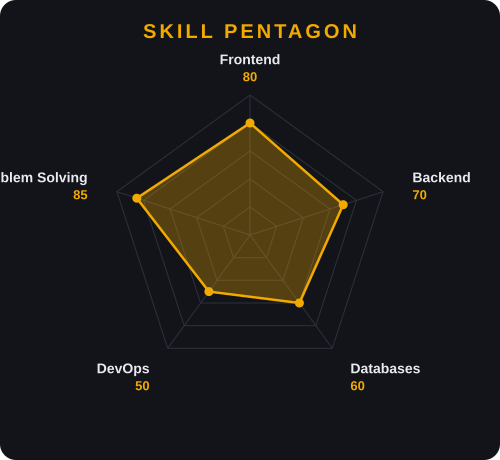

<h1 align="center">Hey there, I'm YOUR_NAME 👋</h1>

  <i>Developer • Builder • Always levelling up 🎮</i>  
  
  

---

## 🎯 Player Stats

  

---

## 🧰 Loadout

  
  
  
  
  
  
  
  

---

## 🔥 Current Missions

- 🔭 Working on: **YOUR_PROJECT**
- 🌱 Learning: **YOUR_NEW_SKILL**
- 🤝 Looking to collaborate on: **YOUR_INTEREST**
- 💬 Ask me about: **YOUR_TOPIC**

---

## 📊 GitHub Stats

  
  

---

## 📫 Connect With Me

  
  
  

<i>"Winner winner, chicken dinner" — but for clean commits. 🍗</i>

